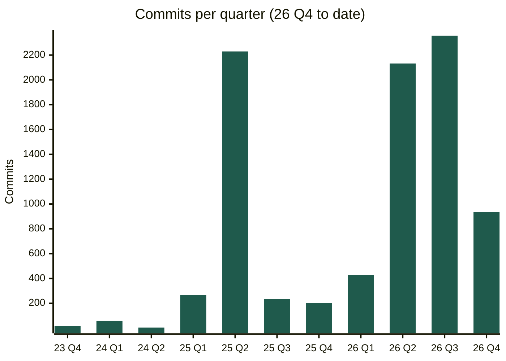

# Quentin Mitchell

**AI Engineer | Agent Orchestration & Production Systems.** Burlington, ON · open to remote · [1quentin.mitchell@gmail.com](mailto:1quentin.mitchell@gmail.com) · [LinkedIn](https://www.linkedin.com/in/quentin-mitchell-55a4b92a2/) · [github.com/Mitch515](https://github.com/Mitch515) · [getwealthnavigator.com](https://getwealthnavigator.com) · [Little Brick Things (live store)](https://little-brick-things.lego-etsy.workers.dev/)

Anchored in Computer Science, I orchestrate swarms of AI agents across Claude Code, Codex, and Cursor to produce production-grade software. Since January 2025: **8,700+** commits across 35 repositories. In the last 90 days: **3,300+** agent sessions processing **83B** tokens. My approach combines technical rigor, commercial acumen, and end-to-end operational ownership.

**Now:** Software Lead at [Wealth Navigator](https://getwealthnavigator.com). Delivered an in-house sales platform from first commit to live calling in 7 weeks: Twilio browser softphone, call recording, transcription, AI call notes and outcomes, AI research on every lead, and a Postgres CRM. Since August: **2,000+** calls, **6,700** leads, **11,500+** research jobs, and **10,000+** logged interactions.

**Before:** Co-Founder of Top Frag. Scaled the academy to **6,000+** members and **$100K+** in first-year revenue; achieved **2M+** monthly YouTube views within two months of launch.

Most of my work lives in private repositories and organizations, so little of it shows here. Counted from git, that's 8,858 commits since 2023.

## Things I've built

| Project | What it is | Stack |
|---|---|---|
| **Wealth Navigator platform** | Architected the client platform: an operator dashboard, a client approval portal for advisors, marketing sites, background jobs, LinkedIn automation, and an in-product AI agent that researches, drafts, and runs workflows. The agent and the dashboard share one service layer, which an MCP server also opens to outside AI agents. | TypeScript, SvelteKit, Postgres, Drizzle, Redis/BullMQ, Railway |
| **swarmd** | Supervisor for fleets of Claude and Codex coding agents: verifies each agent's model, pauses at usage limits without spending retries, and stops two agents from editing the same files. | TypeScript, SQLite |
| **CLI Lake** | Desktop manager for coding-agent CLIs; a Rust daemon runs projects, repositories, and terminal sessions behind one React interface. | Rust, React, Electron |
| **canvas-io** | Coding-agent workspace on an infinite canvas, with an independent agent per card and GraphQL streaming. | SvelteKit, GraphQL, Vercel AI SDK |
| [Little Brick Things](https://little-brick-things.lego-etsy.workers.dev/) | Live gift store taking real payments; Python pipelines render the product images. | Cloudflare Workers, D1, Stripe |

## Agent usage

Agent sessions, Jul to Oct 2026: **3,315** sessions, **83.1B** tokens processed.

| Tool | Sessions | Tokens |
|---|--:|--:|
| Claude Code | 919 | 48.2B |
| Codex | 1,521 | 33.1B |
| Cursor | 831 | 1.72B |
| OpenCode | 44 | 119M |

Full résumé: [resume.md](https://github.com/Mitch515/Mitch515/blob/main/resume.md)
