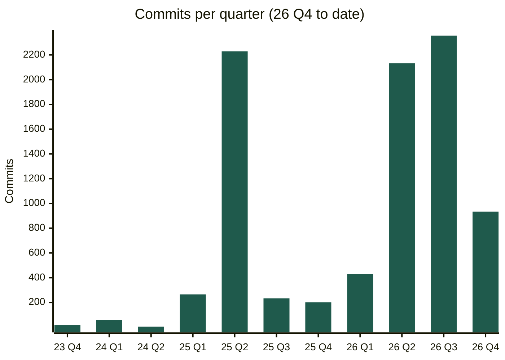
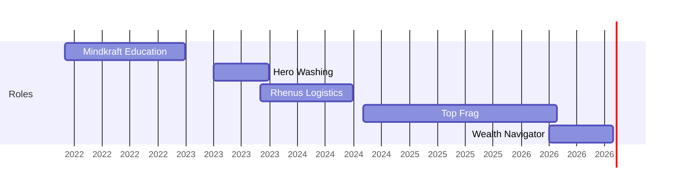

# Quentin Mitchell

**AI Engineer | Agent Orchestration & Production Systems**

Burlington, ON · open to remote · [1quentin.mitchell@gmail.com](mailto:1quentin.mitchell@gmail.com) · [LinkedIn](https://www.linkedin.com/in/quentin-mitchell-55a4b92a2/) · [github.com/Mitch515](https://github.com/Mitch515) · [getwealthnavigator.com](https://getwealthnavigator.com) · [Little Brick Things (live store)](https://little-brick-things.lego-etsy.workers.dev/)

Anchored in Computer Science, I orchestrate swarms of AI agents across Claude Code, Codex, and Cursor to produce production-grade software. Since January 2025: **8,700+** commits across 35 repositories. In the last 90 days: **3,300+** agent sessions processing **83B** tokens. My approach combines technical rigor, commercial acumen, and end-to-end operational ownership.

## Experience

### Wealth Navigator · Software Lead
`Apr 2026 – Present` · Lead-generation agency running LinkedIn, email, and phone outreach for financial advisors; I lead all of its software.

- Architected the client platform: an operator dashboard, a client approval portal for advisors, marketing sites, background jobs, and an in-product AI agent that researches, drafts, and runs workflows on one service layer, which an MCP server also opens to outside AI agents.
- Engineered a LinkedIn courtship engine: one durable AI agent per prospect runs the campaign playbook, from engaging with posts to connecting and messaging, through multi-step workflows that draft human-sounding comments and DMs. Since May: **26,000+** prospects AI-analyzed and **9,700+** LinkedIn actions, including **1,900+** comments; a pilot advisor's monthly comments grew over 12x in four months.
- Delivered an in-house sales platform from first commit to live calling in 7 weeks: Twilio browser softphone, call recording, transcription, AI call notes and outcomes, AI research on every lead, and a Postgres CRM. Since August: **2,000+** calls, **6,700** leads, and **11,500+** research jobs.
- Kept every agent human-in-the-loop: agents draft and stage, people send, and do-not-call, anti-spam (CASL), recording-disclosure, suppression, and duplicate-send checks run in code the agents cannot bypass.
- Built cold-email delivery across 100 mailboxes: one agent writes, another reviews, and an LLM classifies replies.
- Shipped **4,200+** commits and **430+** pull requests in six months by orchestrating swarms of AI agents. Every pull request includes Playwright end-to-end test results and a recorded walkthrough.

`TypeScript` `SvelteKit` `Postgres` `Drizzle` `Redis/BullMQ` `Railway` `Twilio` `Vercel AI SDK` `MCP` `WorkOS` `Microsoft Graph`

### Top Frag · Co-Founder
`Aug 2024 – Apr 2026` · Online coaching academy for the competitive video game Valorant; built the business and its entire software platform.

- Scaled the academy to **6,000+** members and **$100K+** in first-year revenue; achieved **2M+** monthly YouTube views within two months of launch.
- Established a partnership to deliver coaching within the official Valorant Discord server (**2M+** members); coached for Eastern Michigan University's esports program.
- Architected a seven-service platform (Discord bot, staff and student dashboards, scheduler, and AI agent service) on AWS EC2, Docker Compose, Caddy, MongoDB, and Redis. Built the FastAPI and pydantic-ai agent service with full transcript, tool-trace, and evaluator-score audit; a searchable coaching-recording library with whisper.cpp transcription and LLM speaker labels; and Google OR-Tools constraint scheduling.
- Engineered X (Twitter) lead qualification and direct-message automation (Bun, Hono, Redis, Postgres, React), plus Stripe subscriptions and trials.

`TypeScript` `Python` `Bun` `FastAPI` `pydantic-ai` `MongoDB` `Redis` `AWS` `Docker` `Stripe` `Discord.js` `OR-Tools`

### Rhenus Logistics · Junior Business Application Engineer
`Sep 2023 – Jun 2024` · Business application development for a global logistics company's warehouse operations.

- Developed a Python desktop tool that turns Excel exports into heat maps of warehouse storage locations, with saved filters, a local database, and Cython optimization. Collaborated in an agile team on C#/.NET warehouse services and operational workflow automation.

`Python` `C#` `.NET` `SQL`

### Earlier

- **Hero Washing**, Sales Director (Apr 2023 – Sep 2023). Directed sales-team target setting and representative development.
- **Mindkraft Education**, Head of Program Management (Dec 2021 – Dec 2022). Developed and taught coding curricula in Python, Lua, and C++, plus Roblox and Minecraft game development, for ages 6 to 18.

## Commit history

## Agent usage

Agent sessions, Jul to Oct 2026: **3,315** sessions, **83.1B** tokens processed.

| Tool | Sessions | Tokens |
|---|--:|--:|
| Claude Code | 919 | 48.2B |
| Codex | 1,521 | 33.1B |
| Cursor | 831 | 1.72B |
| OpenCode | 44 | 119M |

## Agent tooling and side projects

| Project | What it is | Stack |
|---|---|---|
| **swarmd** | Supervisor for fleets of Claude and Codex coding agents: verifies each agent's model, pauses at usage limits without spending retries, and stops two agents from editing the same files. | TypeScript, SQLite |
| **CLI Lake** | Desktop manager for coding-agent CLIs; a Rust daemon runs projects, repositories, and terminal sessions behind one React interface. | Rust, React, Electron |
| **canvas-io** | Coding-agent workspace on an infinite canvas, with an independent agent per card and GraphQL streaming. | SvelteKit, GraphQL, Vercel AI SDK |
| [Little Brick Things](https://little-brick-things.lego-etsy.workers.dev/) | Live gift store taking real payments; Python pipelines render the product images. | Cloudflare Workers, D1, Stripe |

## Competencies

- **T2B · Technical-to-business communication**. Excellent communicator and collaborative teammate.
- **SDX · Self-directed execution**. Self-motivated, determined, and productive around the clock.
- **Operational foresight**. Organized; works ahead of deadlines.
- **Commercial acumen**. Business, sales, and marketing.
- **Technical tenure**. Working in software for over a decade; working with AI since GPT-3.

## Technical skills

| | |
|---|---|
| **Agent orchestration** | Claude Code, Codex, Cursor, MCP servers, writer/reviewer agents, guardrails in code |
| **Languages** | TypeScript, Python, C#, C++, Java, SQL |
| **Backend** | Node, Bun, Hono, FastAPI, Postgres, Drizzle, MongoDB, Redis/BullMQ, GraphQL |
| **Frontend** | SvelteKit, React, Astro |
| **Infrastructure** | Railway, AWS EC2, Docker, Cloudflare Workers, Vercel |
| **API integrations** | Twilio, Stripe, WorkOS, Microsoft Graph, Discord, OpenAI, Anthropic, OpenRouter |
| **Quality assurance** | Playwright E2E, Vitest, pytest |

## Education

**University of Toronto Mississauga**, Computer Science (2021 – 2023). 3.7 GPA. Left university to pursue entrepreneurial ventures.
